# 🚀 scrape-movies

Day 45 of Udemy's "100 Days of Code: The Complete Python Pro Bootcamp": web scraping with Requests and BeautifulSoup. It parses a local HTML page, scrapes the Hacker News front page and writes Empire's 100 greatest movies to `movies.txt`. It is for fellow coursists and anyone looking for a small, tested scraping example.

## 📚 Table of Contents

- [Overview](#-overview)
- [Requirements](#-requirements)
- [Setup](#-setup)
- [Run](#-run)
- [Tests](#-tests)
- [License](#-license)
- [Links](#-links)
- [Appendix: Project documents](#-appendix-project-documents)

## 🧭 Overview

| Part | What it is for |
| --- | --- |
| `src/scrape_movies/` | The code in clean-architecture layers (`domain`, `application`, `infrastructure`, `presentation`) plus `constants.py`; the lecture steps `soup_basics`, `hacker_news` and the movies scraper follow milestone by milestone |
| `tests/` | pytest tests that run offline against saved pages in `tests/fixtures/` |
| `docs/` | Project documents (business case, plan, milestones, reviews) and the wiki in English, Danish and Bahasa Malaysia |
| `Doxyfile` | Generates the API pages from the Doxygen comments in the source |

The only runtime dependencies are `requests` and `beautifulsoup4`.

## 📋 Requirements

- Python 3.13 or newer (the `venv` module comes with it).
- `requests` and `beautifulsoup4` (installed by the setup below).
- Optional: [Doxygen](https://www.doxygen.nl/) to build the API pages.

## 🛠️ Setup

Create a local virtual environment named `.venv`, update `pip`, then install the project with its test tools.

Windows (PowerShell):

```powershell
python -m venv .venv
.venv\Scripts\Activate.ps1
python -m pip install --upgrade pip
python -m pip install -e ".[dev]"
```

Linux and macOS:

```bash
python3 -m venv .venv
source .venv/bin/activate
python -m pip install --upgrade pip
python -m pip install -e ".[dev]"
```

Leave out `[dev]` to install only the runtime dependencies. Personal tokens belong in a git-ignored `.env`; the project never reads it.

## ▶️ Run

Every lecture step is a command of the form `python -m scrape_movies <lecture> <step>`; without arguments the help is printed. Each step below shows the command, what it teaches and a screenshot of its output.

### Lecture: Parsing HTML and making soup

The sample page is `tests/fixtures/website.html`; the code is `src/scrape_movies/infrastructure/soup_basics.py`.

**1. Create a soup and read the title** (`BeautifulSoup(html, "html.parser")`, `soup.title.string`)

```bash
python -m scrape_movies soup title
```

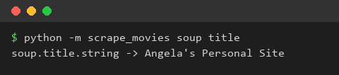

**2. Prettify** (`soup.prettify()` indents one tag per line)

```bash
python -m scrape_movies soup prettify
```

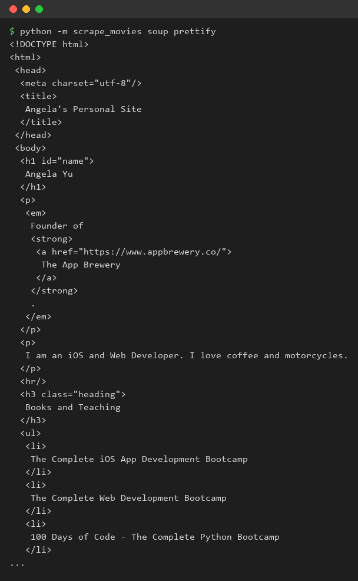

**3. Find all tags** (`find_all("a")`, then `get_text()` and `get("href")` in a loop)

```bash
python -m scrape_movies soup find-all
```

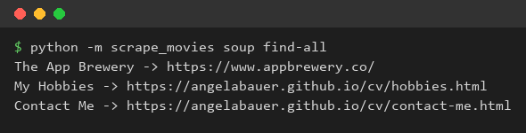

**4. Find by id and by class** (`find(id=...)`, `find_all("h3", class_=...)`; `class_` because `class` is a Python keyword)

```bash
python -m scrape_movies soup find
```

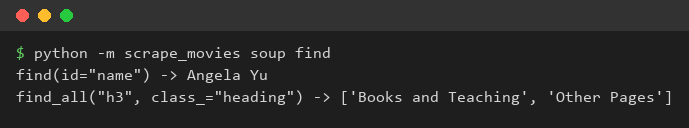

**5. CSS selectors** (`select_one("p a")` and `select(".heading")`)

```bash
python -m scrape_movies soup select
```

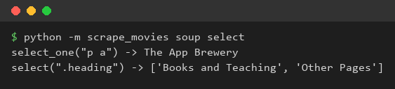

The screenshots are made by `python tools/make_screenshots.py`, which renders the command output as an image; no desktop is captured.

### Lecture: Scraping Hacker News

The code is `src/scrape_movies/infrastructure/hacker_news.py` (parsing) and `http_client.py` (one `requests.get` with a timeout and a `User-Agent`). By default the commands read the course's static copy of the front page, `--source live` reads <https://news.ycombinator.com/news> and `--source fixture` reads the saved copy in `tests/fixtures/` without any network.

**1. Look at the page you will scrape** (live data instead of a local file)

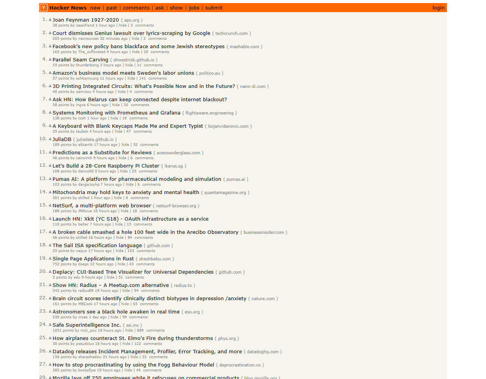

**2. Inspect the markup** (browser developer tools show the tags to look for: a story row `tr.athing`, its title link `.titleline > a`, and a `span.score` in the next row)

```bash
python -m scrape_movies hacker-news markup
```

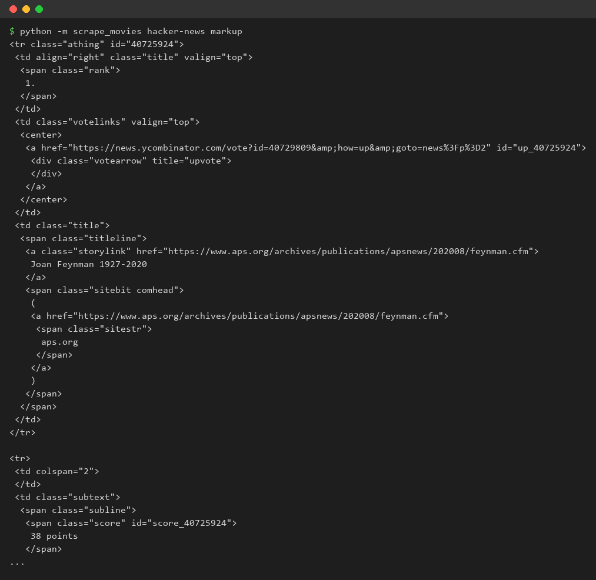

**3. Titles** (`find_all` on the title links, then `get_text()`)

```bash
python -m scrape_movies hacker-news titles
```

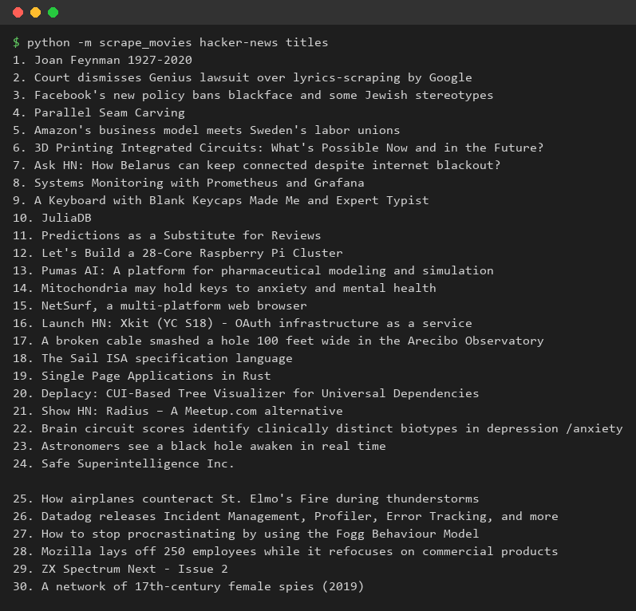

**4. Links** (`get("href")` of the same anchors)

```bash
python -m scrape_movies hacker-news links
```

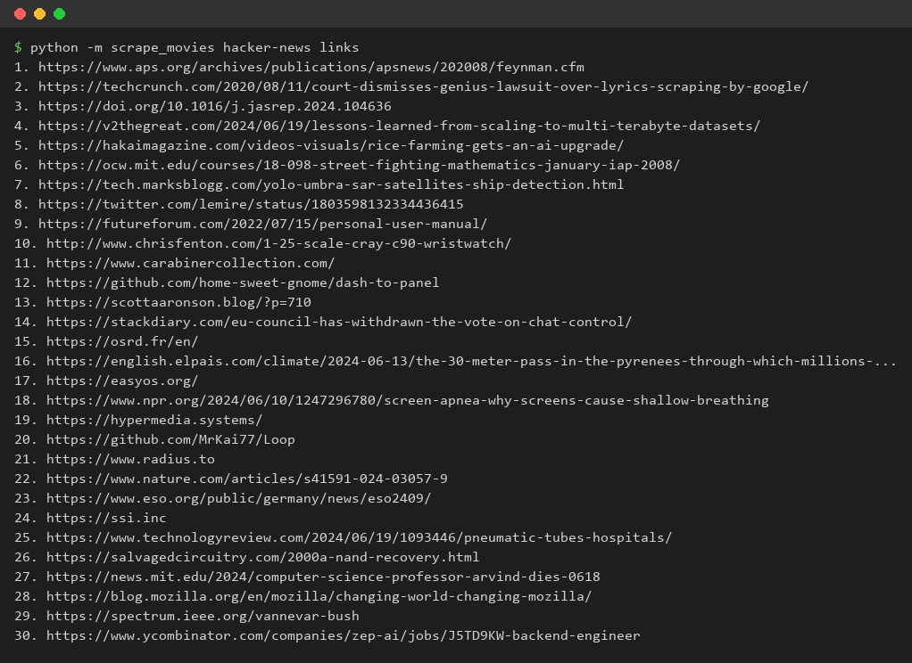

**5. Upvotes** (the text `38 points` is split and converted with `int()` so it can be compared)

```bash
python -m scrape_movies hacker-news upvotes
```

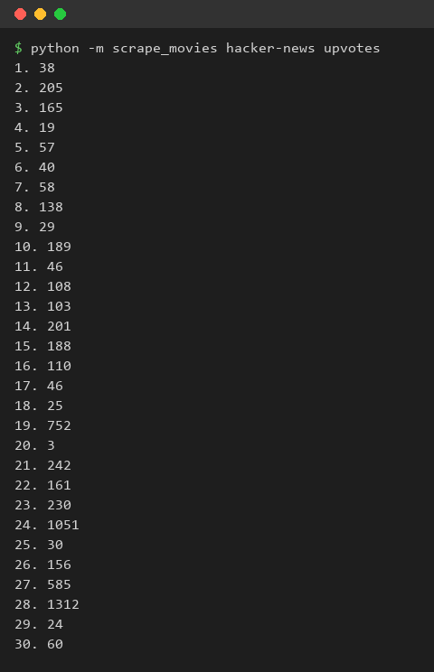

**6. The top story** (Python's `max` over the upvotes)

```bash
python -m scrape_movies hacker-news top
```

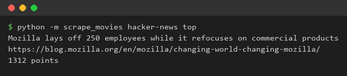

### Lecture: Is web scraping legal and ethical?

A short summary in our own words; it is not legal advice.

- **Public, non-copyrighted data** is generally fine to read. Court cases such as Genius v. Google and hiQ v. LinkedIn show that the line is not simple.
- **Copyrighted content** (a video, a blog post) must not be copied, and **data behind a login** is covered by the site's user agreement, so do not scrape it.
- **Commercial use** of scraped data invites expensive disputes even where the scraping itself was allowed.
- **Be a good guest:** prefer an official API when there is one, read the site's `robots.txt` to see what it allows, and send at most one request a minute. This project fetches one page per run and identifies itself with a `User-Agent`.

## 🧪 Tests

```bash
python -m pytest
```

The tests use saved pages and never touch the network. Lint and types: `ruff check .`, `ruff format --check .` and `mypy src tests`. API pages: `doxygen Doxyfile`.

## 📄 License

See [LICENSE](./LICENSE).

## 🔗 Links

- [Repository][repository]
- [Documentation][documentation]
- [Issue tracker][issues]

## 📎 Appendix: Project documents

| Document | What it tells you |
| --- | --- |
| [AGENTS.md][agents] | The rules AI agents follow in this repository |
| [Business Case][BC-001] | Why the project exists, its scope and success criteria |
| [Stakeholder Analysis][SA-001] | Who is involved; the stakeholder IDs used for owners and reviewers |
| [Project Plan][PP-001] | The gateways and their schedule |
| [Milestones][milestones] | One document per gateway: Go/No-Go criteria and tasks |
| [Artifact registry][registry] | Where each artifact type lives, the next version, the PO language and domain |
| [Framework README][framework-readme] | The framework this project uses |
| [Framework changelog][framework-changelog] | What changed in each framework release |

---

[repository]: https://git.tirsystem.com/Tirsvad-Udemy-100-days-of-code/045-scrape-movies
[documentation]: https://git.tirsystem.com/Tirsvad-Udemy-100-days-of-code/045-scrape-movies/wiki
[issues]: https://git.tirsystem.com/Tirsvad-Udemy-100-days-of-code/045-scrape-movies/issues
[agents]: ./AGENTS.md
[BC-001]: ./docs/business-case.md
[SA-001]: ./docs/stakeholder-analysis.md
[PP-001]: ./docs/project-plan.md
[milestones]: ./docs/milestones/
[registry]: ./docs/artifact-registry.md
[framework-readme]: ./framework/README.md
[framework-changelog]: ./framework/CHANGELOG.md
