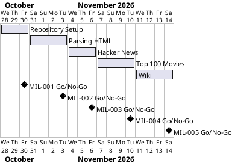

# Project Plan

## Metadata
| Key | Value |
| --- | --- |
| ID | PP-001 |
| CrossReference | [BC-001], [SA-001], [MIL-001], [MIL-002], [MIL-003], [MIL-004], [MIL-005] |
| Language | en |
| Domain | it |

## Version History
| Date | Status | Author | Reviewer | Change | Commit |
| --- | --- | --- | --- | --- | --- |
| 2026-10-28 | Accepted | Jens Tirsvad Nielsen | S01 (AI as stand-in, autonomous mode) | Initial version | [dcef5e6] |

---

## Purpose

Schedule the five gateways that deliver the Day 45 scraping repository. The Business Case sets no deadline, so the plan only fixes the order and a working window per gateway.

## Planning Assumptions

- Week 1 starts 2026-10-28; the plan ends by 2026-11-14 (no hard deadline in [BC-001]).
- Phase length: two to four days; each phase is one branch and one pull request.
- Communication follows [SA-001]: plan acceptance in chat, one pull request per milestone, run summary at the end.
- Autonomous mode: S01 accepts this plan once; the AI then runs every gateway and acts as stand-in reviewer, recorded in each RC record.

## Gateway Schedule

| Gateway | Document | Window | Decision date | Owner | Stories | Main deliverable | Milestone |
| --- | --- | --- | --- | --- | --- | --- | --- |
| Repository Setup | [MIL-001] | 2026-10-28 to 2026-10-30 | 2026-10-30 | S01 | none (technical tasks) | Repository metadata, configuration, README, CI | not yet synced |
| Parsing HTML | [MIL-002] | 2026-10-31 to 2026-11-03 | 2026-11-03 | S01 | none (technical tasks) | `soup_basics` module, tests, screenshots | not yet synced |
| Hacker News | [MIL-003] | 2026-11-04 to 2026-11-06 | 2026-11-06 | S01 | none (technical tasks) | `hacker_news` module, ethics note, screenshots | not yet synced |
| Top 100 Movies | [MIL-004] | 2026-11-07 to 2026-11-10 | 2026-11-10 | S01 | none (technical tasks) | `movies` module and `movies.txt`, screenshots | not yet synced |
| Wiki | [MIL-005] | 2026-11-11 to 2026-11-14 | 2026-11-14 | S01 | none (technical tasks) | Wiki in en, da, ms | not yet synced |



## Scope Coverage

| Business Case scope item | Gateway |
| --- | --- |
| `pyproject.toml`, `.gitignore`, `Doxyfile`, `constants.py`, README skeleton | [MIL-001] |
| Repository description and topics, workflows | [MIL-001] |
| Parsing HTML, finding and selecting elements | [MIL-002] |
| Hacker News scraping and the ethics note | [MIL-003] |
| 100 movies and `movies.txt` | [MIL-004] |
| Wiki in en, da, ms and screenshots per step | [MIL-005] (screenshots are taken in MIL-002 to MIL-004) |

## Dependencies

```
MIL-001 → MIL-002 → MIL-003 → MIL-004 → MIL-005
```

A No-Go on a gateway is fixed and re-reviewed; after three failed rounds the run stops and reports (AGENTS.md). Later dates move by the same amount; S01 decides a move of the end date.

## Plan Risks

| Risk | Impact | Mitigation |
| --- | --- | --- |
| Target repository name differs from the one named in the request | Metadata set on the wrong repository | Resolved: S01 chose the origin remote at plan acceptance |
| Reusable workflow path differs (`TirSystem/git-workflows` in the template, `TirSystem/github-action` named in the request) | Workflow calls fail | Verify the path on the host in MIL-001 before installing |
| Danish and Malay translation quality | Review finds errors | Keep sentences short; English is authoritative |
| Network access to Wayback during the run | Fixture cannot be saved | Retry once; alternative live Empire URL |

## Open Issues

- Target repository: S01 chose the origin remote (`Tirsvad-Udemy-100-days-of-code/045-scrape-movies`) when accepting the plan; the named `Tirsvad-Udemy-100_days_of_code` is not used.
- Wiki publication is a scoped workflow in `TirSystem/github-action` (no file needed) while the framework template `publish-wiki.yml` also exists; MIL-001 records which one applies.
- "Screenshot per lecture step" is planned as rendered terminal output and browser-pane captures, never host desktop capture.

---

[BC-001]: ./business-case.md
[SA-001]: ./stakeholder-analysis.md
[MIL-001]: ./milestones/mil-001-repository-setup.md
[MIL-002]: ./milestones/mil-002-parse-html.md
[MIL-003]: ./milestones/mil-003-hacker-news.md
[MIL-004]: ./milestones/mil-004-top-100-movies.md
[MIL-005]: ./milestones/mil-005-wiki.md
[dcef5e6]: https://git.tirsystem.com/Tirsvad-Udemy-100-days-of-code/045-scrape-movies/commit/dcef5e6e6e7ec16162817d3ec0ce1b303e0a3a63
